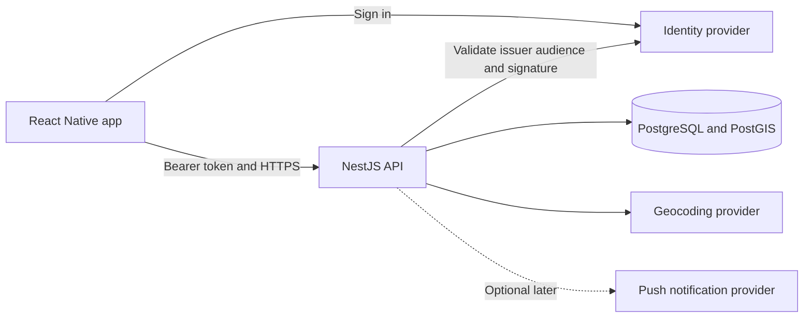

# Application architecture

Use a NestJS modular monolith backed by PostgreSQL with PostGIS, and a React Native application built with Expo and TypeScript. This keeps the initial system manageable while giving location search database support and allowing independent mobile and API releases.

## Proposed technology choices

| Area | Choice | Purpose |
| --- | --- | --- |
| Mobile | React Native, Expo, TypeScript, Expo Router | iOS and Android app with shared navigation and builds |
| Device location | Expo Location | Foreground permission handling and one-time position lookup |
| Server state | TanStack Query | Fetching, invalidation, pagination, and mutation feedback |
| Forms | React Hook Form and Zod | Client input validation and useful field errors |
| API | NestJS with TypeScript and REST | Feature modules, validation, guards, and service boundaries |
| API contract | NestJS OpenAPI generation | Documented endpoints and generated mobile client types |
| Database | PostgreSQL with PostGIS | Transactions, relational constraints, and geographic indexing |
| Persistence | TypeORM migrations and parameterized PostGIS queries | Explicit schema changes and location search |
| Authentication | Managed identity provider, selected in step 0 | Login, verification, and recovery without building password storage |
| Local services | Docker Compose | Reproducible PostgreSQL and PostGIS development environment |
| CI and deployment | Provider selected in step 0 | Automated validation and separate staging and production environments |

Choose currently supported stable framework versions during scaffolding and commit each lockfile. Do not pin speculative versions in this plan. A map or geocoder provider must be selected before manual town search is implemented, considering coverage, cost, storage terms, and attribution.

## System boundaries

Token signature keys should be cached according to the provider's guidance; validating a token must not require a remote request on every API call. Store authentication tokens in device secure storage and enforce all authorization rules on the API.

## Backend modules

- `Auth`: token verification and authenticated user resolution.
- `Users`: display profiles, preferences, and deletion requests.
- `Venues`: public search locations and protected private addresses.
- `Sessions`: drafts, publishing, editing, cancellation, and lifecycle jobs.
- `Participation`: requests, approvals, withdrawal, and capacity transactions.
- `Discovery`: geographic filtering, distance sorting, and pagination.
- `Moderation`: basic reports and operator actions before public launch.
- `Health`: liveness, readiness, and dependency status.

Controllers validate requests, guards enforce access, and services own business rules. Database transactions span session and participation changes. Start without Redis, microservices, websockets, or a separate message broker. Add a transactional outbox if reliable asynchronous notifications become part of a later release.

## Mobile modules

Organize code by authentication, discovery, sessions, hosting, participation, and profile. Keep navigation routes small and place API access, secure token storage, and location services behind shared adapters.

The API is authoritative for capacity and membership. Invalidate session detail, discovery, and personal lists after participation changes. An optimistic UI must never show a confirmed seat before the server approves it. Avoid persistent caching of private venue details; clear sensitive query data when signing out or losing access.

## Geographic search

1. Accept latitude, longitude, radius in kilometers, date range, filters, and pagination. Validate coordinate ranges, cap radius at 100 km, page size at 50, and the search window at 90 days.
2. Store public discovery positions as PostGIS `geography(Point, 4326)` and create a GiST index. Construct points with longitude first and latitude second.
3. For public venues, use their published location. For private venues, use the host's selected neighborhood or area centroid as the discovery position; store the exact address and point separately.
4. Apply `ST_DWithin` to the discovery position using meters, then calculate and sort distance with `ST_Distance`. The radius filter and ordering must use the same public position. Never search against a secret point and merely round its returned distance.
5. Return rounded approximate distances, public location fields, and current available seats. Filter published future sessions using confirmed participation counts.
6. Begin with bounded offset pagination, defaulting to 20 results. Use stable secondary ordering by start time and session ID; results may move as capacity changes. Revisit cursor pagination after measuring demand.

Private venue search is approximate by design: neighborhood boundaries may affect whether a session appears near the edge of a radius. Show an approximate area label. Expose exact private details through a separate endpoint authorized for the host or an approved player, and revoke access after withdrawal, cancellation, or completion.

Device coordinates are request data for discovery. Do not maintain a history of player movement. Redact location query parameters from API, proxy, analytics, and error logs. Use foreground location on explicit actions; do not enable background tracking.

## Repository responsibilities

The API repository owns the schema, migrations, API, OpenAPI export, database fixtures, and API CI. The app repository owns the mobile experience, generated API client, device configuration, and mobile CI.

Publish a versioned OpenAPI artifact from backend CI, then update the app client in a reviewed app change. Keep additive changes compatible with older installed app versions. Use `/v1` for the initial API and maintain a staging API that development builds can reach from physical devices.

Secrets belong in deployment secret stores or local ignored environment files. The app may contain a public API base URL and provider publishable keys, but it must never contain database credentials, token-signing secrets, or privileged service keys.
