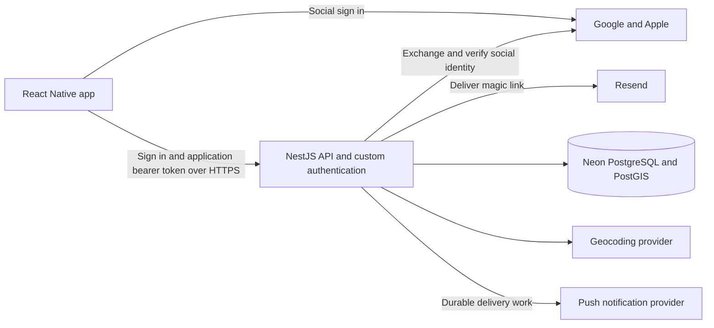

# Application architecture

Use a NestJS modular monolith backed by PostgreSQL with PostGIS, and a React Native application built with Expo and TypeScript. This keeps the initial system manageable while giving location search database support and allowing independent mobile and API releases.

## Proposed technology choices

| Area | Choice | Purpose |
| --- | --- | --- |
| Mobile | React Native, Expo, TypeScript, Expo Router | iOS and Android app with shared navigation and builds |
| Device location | Expo Location | Foreground permission handling and one-time position lookup |
| Server state | TanStack Query | Fetching, invalidation, pagination, and mutation feedback |
| Forms | React Hook Form and Zod | Client input validation and useful field errors |
| API | NestJS with TypeScript and REST | Feature modules, validation, guards, and service boundaries |
| API contract | NestJS OpenAPI generation | Documented endpoints and generated mobile client types |
| Database | PostgreSQL with PostGIS | Transactions, relational constraints, and geographic indexing |
| Persistence | TypeORM migrations and parameterized PostGIS queries | Explicit schema changes and location search |
| Authentication | Custom NestJS authentication with email magic links, Google, and Apple | Backend owns application accounts, sessions, access tokens, and refresh tokens |
| API hosting | Vercel | NestJS runs as a request-based Vercel Function; scheduled work uses bounded invocations |
| Managed database | Neon PostgreSQL with PostGIS | Separate production and staging resources and credentials |
| Email delivery | Resend | English and Italian authentication emails |
| Push delivery | Expo push service proposed | In-app and push are confirmed; provider choice is an implementation proposal |
| Local services | Docker Compose | Reproducible PostgreSQL and PostGIS development environment |
| CI | GitHub Actions standard runners, confirmed | Linux for API/Android and macOS for iOS; public repositories and included storage only |

Choose currently supported stable framework versions during scaffolding and commit each lockfile. Select global geocoding and detail-map providers for venue entry, city resolution, and approved-participant maps, considering coverage, cost, storage terms, and attribution.

## System boundaries

The API validates its own application access tokens. Google and Apple credentials are verified during social sign-in, then exchanged for our application session. Cache external public verification keys according to their providers' guidance. Store app tokens in device secure storage and enforce authorization rules on the API.

## Confirmed authentication methods

Support email magic links, Google sign-in, and Apple sign-in in the Expo app on iOS and Android. The NestJS authentication module owns local users, identity associations, login challenges, and application sessions. Google and Apple remain external identity providers for their respective sign-in methods; Resend delivers authentication emails.

- Generate cryptographically random magic-link tokens, store only their hashes, enforce expiry, and consume them atomically once. Opening the link must not expose a long-lived application credential in a URL.
- Integrate Google and Apple using maintained authentication libraries and their supported flows. Validate issuer, audience, signature, expiry, and transaction state or nonce; apply PKCE where the selected authorization-code flow supports it. Keep privileged credentials on the API.
- Issue short-lived application access tokens and rotating refresh tokens linked to a server-side authentication session. Store refresh token hashes, track rotation and reuse, and support revocation and logout from one or all devices.
- Rate-limit link requests, token consumption, and refresh operations. Use consistent link-request responses for existing and unknown addresses. Redact credentials from logs and analytics.
- Handle expired or reused links, cancelled social sign-in, failed callbacks, and revoked sessions in the app before updating signed-in state.

Authentication library choices, token lifetimes, key rotation schedule, and account linking policy remain open. One local user can have multiple authentication identities; attaching another identity requires a defined ownership verification flow. Do not automatically merge accounts based only on matching email addresses while that policy is unresolved.

Use established libraries for cryptography and authentication protocols. Backend ownership includes maintaining the authentication implementation and its security tests. Reference the [NestJS authentication documentation](https://docs.nestjs.com/security/authentication), [OWASP email token guidance](https://cheatsheetseries.owasp.org/cheatsheets/Forgot_Password_Cheat_Sheet.html), and [OWASP OAuth guidance](https://cheatsheetseries.owasp.org/cheatsheets/OAuth2_Cheat_Sheet.html) during implementation.

## Backend modules

- `Auth`: magic-link challenges, Google and Apple integration, identity resolution, application token issuance and verification, refresh rotation, and authentication session revocation.
- `Users`: display profiles, preferences, and deletion requests.
- `Venues`: public search locations and protected private addresses.
- `Sessions`: drafts, editable business fields and host participation, versioned updates, publishing, cancellation, and lifecycle jobs.
- `Participation`: requests requiring host approval, optional approved host membership, withdrawal, and capacity transactions.
- `Discovery`: geographic filtering, distance sorting, and pagination.
- `Moderation`: basic reports and operator actions before public launch.
- `Notifications`: initial inbox snapshot, device tokens, preferences, versioned UI event payloads, event-triggered push dispatch, and receipt handling.
- `Health`: liveness, readiness, and dependency status.

Controllers validate requests, guards enforce access, and services own business rules. Database transactions span session changes, participation, in-app notifications, and delivery event records. Keep the API a modular monolith without self-hosted Redis, microservices, or websockets; validate a durable event-triggered delivery adapter for the MVP notification flow.

## Vercel deployment and scheduled work

Deploy NestJS on Vercel and connect to Neon over TLS with a bounded connection pool. Use a direct migration connection where the selected migration tooling needs one, and execute migrations as a controlled release step rather than on every request. Validate the production PostgreSQL/PostGIS versions and transaction behavior in staging. [Vercel NestJS support](https://vercel.com/docs/frameworks/backend/nestjs), [Neon pooling](https://neon.com/docs/connect/connection-pooling), and [Neon PostGIS](https://neon.com/docs/extensions/postgis) guide the setup.

The accepted budget permits Vercel Hobby, Neon Free, and Resend Free only, with included service resources and no paid fallback. Validate Vercel's personal/non-commercial eligibility, free compute/storage/transfer quotas, and the durable adapter's no-charge behavior. A free plan can suspend service at its limits; global geographic support is not a promise of unlimited free capacity. Resend public email delivery also depends on an existing verified domain, whose availability is unresolved. See the [operating constraints](./operational-proposal.md).

Do not rely on a permanent process or in-memory timer for notification delivery, session completion, or retention cleanup. Notifications are event-triggered: use a durable Vercel workflow or queue adapter with bounded handlers, retry metadata, idempotency keys, and duplicate-safe processing. The delivery adapter remains a proposal to validate during scaffolding. Do not schedule periodic notification-table scans.

Keep the business transaction and durable delivery handoff recoverable. A database commit followed by untracked fire-and-forget sending is insufficient: the proposed durable operation persists its operation ID before the business step, makes the database step idempotent, and retries the later dispatch step after a crash. Validate that recovery contract with the selected SDK before implementation. Session-end tasks are scheduled for the session's version and revalidate that version after time edits; retention cleanup can use a bounded daily maintenance invocation. [Vercel Workflows](https://vercel.com/docs/workflows) and [Queues](https://vercel.com/docs/queues) are implementation candidates.

Use separate Vercel projects for staging and production, with separate Neon projects or equivalently isolated resources and credentials. Staging can use its own production deployment of `dev` to exercise scheduled jobs; preview deployments must not be assumed to run the production schedule. Gate production delivery from `main` on the release process and keep test notifications confined to test accounts. Verify current [scheduler behavior](https://vercel.com/docs/schedules/cron-jobs/manage-cron-jobs) during implementation.

## Session edits and notifications

All editable session business fields can be changed by the personal-account host, including venue, time, format, capacity, and host participation. Apply the edit under the same session row lock as approvals, check the resulting confirmed count, and increment a version to reject stale concurrent edits. A host opting out withdraws their player membership but retains ownership; opting in approves their membership only if a seat is available.

Create the affected recipients' in-app notifications and delivery event records in that transaction. Use safe versioned payloads containing event and notification IDs, session ID, aggregate version, event type, and a complete small projection of the public status/count/time/city and recipient-membership fields updated by the listener. Increment the aggregate version for every state-changing session or participation operation, not only host edits. Avoid partial patches that lose an earlier field update when a newer event arrives first. Keep payloads within the chosen push provider's size limit and exclude exact addresses, coordinates, credentials, and long user-authored content. Recheck authorization when the user requests protected location detail. Session location snapshots or owned venue revisions keep edits from silently relocating unrelated games.

Proposed events cover requests, approvals, rejections, withdrawals, cancellations, and material session edits. Push dispatch records tickets and receipts, retries transient failures, disables invalid device tokens, and tolerates duplicate delivery. The in-app inbox remains authoritative if push is denied or delayed. Store no exact address in push text. [Expo documents its delivery semantics](https://docs.expo.dev/push-notifications/faq/).

Load the notification inbox and personal-session snapshot once on authenticated app entry. In the foreground, the push listener deduplicates event IDs, rejects older aggregate versions, and patches the query cache and inbox directly; it does not refetch the inbox, session, or database on every push. Mutation responses also update local state. Clear cached exact locations immediately on a revocation or cancellation event, and never grant protected location access from a push alone.

Push delivery is best-effort and background apps may not execute a listener. Use one reconciliation snapshot on launch, login, or foreground re-entry, plus explicit user refresh, to recover missed events. This is event-based recovery, not timed polling. With push disabled, the inbox remains available through those one-shot reads; real-time updates are not promised without a delivery channel. Opening an authorized map or another uncached detail still performs its normal protected API request.

## Mobile modules

Organize code by authentication, discovery, sessions, hosting, participation, and profile. Keep navigation routes small and place API access, secure token storage, and location services behind shared adapters.

The API is authoritative for capacity and membership. Apply command responses and received push projections to the cache directly; do not invalidate active queries in a way that causes a read for every push. Load uncached detail on explicit navigation and use one-shot entry/re-entry recovery. An optimistic UI must never show a confirmed seat before server approval. Avoid persistent caching of exact locations and clear sensitive query data when signing out or losing access.

## Geographic search

Hosting accepts valid locations worldwide. Discovery uses the current foreground device position wherever the player is, without a manually selected destination or a launch-country allowlist. On permission denial or location failure, expose settings and retry actions while keeping personal session lists available.

Choose global geocoding coverage and support manual venue positioning during hosting when an address cannot be resolved. Address input supports international formats. The location label before approval is a canonical city, rather than a street, neighborhood, venue name, or host-selected precise point. Worldwide support does not require a deployment in every region.

1. Accept latitude, longitude, radius in kilometers, date range, filters, and pagination. Validate coordinate ranges, cap radius at 100 km, page size at 50, and the search window at 90 days.
2. Store canonical city centroids as PostGIS `geography(Point, 4326)` with a GiST index. All sessions in one city reference its shared discovery point. Keep exact session coordinates separately protected for every venue type.
3. Resolve the device's current city. Include eligible sessions in that city and use the radius to include nearby city centroids; this avoids excluding the user's city merely because its center is far away. Geographic ranking is city-level and never based on a secret venue point.
4. Apply `ST_DWithin` and `ST_Distance` to city discovery points in meters for neighboring-city filtering and ranking. These approximate search semantics need representative large-city and boundary tests; do not filter or sort on exact venue coordinates before approval.
5. Return city labels and available seats, with no address, venue name, map coordinates, or precise distance. Filter published future sessions using confirmed participation counts.
6. Begin with bounded offset pagination, defaulting to 20 results. Use stable secondary ordering by start time and session ID; results may move as capacity changes. Revisit cursor pagination after measuring demand.

Discovery is city-level and approximate. Both the list and unapproved detail expose only the city, including for public venues. A separate endpoint authorizes the host or an active approved participant to retrieve the exact address and map point in session detail. Revoke participant access after withdrawal, cancellation, or completion. An approved player opening a discovery card still receives a city-only card; precise detail requires the protected request.

Device coordinates are request data for discovery. Do not maintain a history of player movement. Redact location query parameters from API, proxy, analytics, and error logs. Use foreground location on explicit actions; do not enable background tracking.

## English and Italian localization

Keep English and Italian translation catalogs, identified by `en` and `it`, for interface text, validation and recovery messages, and authentication email templates. Store the user's preferred interface locale separately from a session's play language and timezone. User-authored titles, descriptions, and venue names are preserved as entered.

The proposed initial selection uses the device language when supported, otherwise English, with an explicit language setting that persists for the user. Format dates, times, numbers, and plurals for the selected locale. Keep session time interpretation tied to the venue's IANA timezone and UTC storage, independently of the interface language or device timezone.

Return stable machine-readable API error codes for the app to localize. Carry an explicit supported locale for pre-login magic-link requests so email templates use the chosen language. Verify complete translation keys and text expansion on both mobile platforms during testing.

## Repository responsibilities

The API repository owns the schema, migrations, API, OpenAPI export, database fixtures, and API CI. The app repository owns the mobile experience, generated API client, device configuration, and mobile CI.

Publish a versioned OpenAPI artifact from backend CI, then update the app client in a reviewed app change. Keep additive changes compatible with older installed app versions. Use `/v1` for the initial API and maintain a staging API that development builds can reach from physical devices.

Use the [Git workflow](./git-workflow.md) in all three repositories. Validated `dev` changes feed staging; tagged releases on `main` identify production API artifacts and mobile release builds. API and app versions advance independently and must remain compatible with installed app versions.

Secrets belong in deployment secret stores or local ignored environment files. The app may contain the public API base URL and public OAuth client identifiers, but it must never contain database credentials, token-signing keys, OAuth client secrets, Apple signing credentials, or email service credentials.
