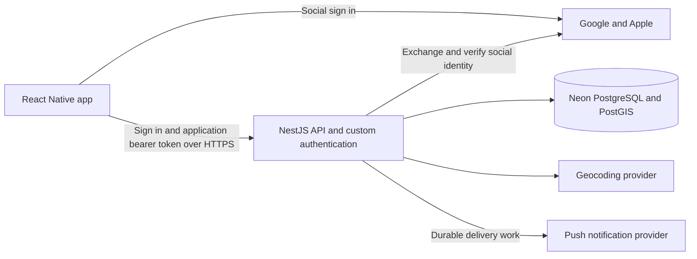

# Application architecture

Use a NestJS modular monolith backed by PostgreSQL with PostGIS, and a React Native application built with Expo and TypeScript. This keeps the initial system manageable while giving location search database support and allowing independent mobile and API releases.

## Accepted technology choices

| Area | Choice | Purpose |
| --- | --- | --- |
| Mobile | React Native, Expo, TypeScript, Expo Router | iOS and Android app with shared navigation and builds |
| Device location | Expo Location | Foreground permission handling and one-time position lookup |
| Server state | TanStack Query | Fetching, invalidation, pagination, and mutation feedback |
| Forms | React Hook Form and Zod | Client input validation and useful field errors |
| API | NestJS with TypeScript and REST | Feature modules, validation, guards, and service boundaries |
| API contract | NestJS OpenAPI generation | Documented endpoints and generated mobile client types |
| Database | PostgreSQL with PostGIS | Transactions, relational constraints, and geographic indexing |
| Persistence | TypeORM migrations and parameterized PostGIS queries | Explicit schema changes and location search |
| Authentication | Google and Apple only, with NestJS-owned application sessions | Explicit linking, immediate revocation, and native/browser flows as specified in the authentication document |
| API hosting | Vercel | NestJS runs as a request-based Vercel Function; scheduled work uses bounded invocations |
| Managed database | Neon PostgreSQL with PostGIS | Separate production and staging resources and credentials |
| Push delivery | Expo push service and expo-server-sdk | APNs/FCM transport with authoritative in-app notifications and bounded durable retries |
| Local services | Docker Compose | Reproducible PostgreSQL and PostGIS development environment |
| CI | GitHub Actions standard runners, confirmed | Linux for API/Android and macOS for iOS; public repositories and included storage only |

Use npm and supported stable versions compatible with Expo/NestJS, pinned in lockfiles during scaffolding. Use Expo development builds, not Expo Go, for native authentication/maps. Geoapify Free supplies geocoding/city resolution and the osm-bright map style; MapLibre React Native renders approved-detail maps. See the [operating policy](./operations.md) for quotas, attribution and privacy. Use i18next/react-i18next with Expo Localization, expo-secure-store, Nest ValidationPipe/class-validator, nestjs-pino structured redacted logging, and standard GitHub Actions. Dependency patch selection is an implementation task, not an open architecture decision.

## System boundaries

Google and Apple authenticate the external identity; the API owns application authorization. The authentication specification defines credential verification and device token storage.

## Authentication boundary

NestJS verifies Google/Apple credentials and owns internal users, authorization and application sessions. The complete platform/library, onboarding, linking, token, key and revocation specification is in [Authentication](./authentication.md).

## Backend modules

- `Auth`: Google/Apple verification, internal identity resolution/linking, application tokens, refresh rotation, and session revocation.
- `Users`: display profiles, preferences, and deletion requests.
- `Venues`: owner-managed saved venues, canonical city references and separately protected exact locations for every venue type.
- `Sessions`: drafts, editable business fields and host participation, versioned updates, publishing, cancellation, and lifecycle jobs.
- `Participation`: requests requiring host approval, optional approved host membership, withdrawal, and capacity transactions.
- `Discovery`: canonical city-level filtering/ranking and pagination, with no distance labels in public responses.
- `Moderation`: basic reports and operator actions before public launch.
- `Notifications`: initial inbox snapshot, device tokens, preferences, versioned UI event payloads, event-triggered push dispatch, and receipt handling.
- `Health`: liveness, readiness, and dependency status.

Controllers validate requests, guards enforce access, and services own business rules. Database transactions span session changes, participation, in-app notifications, and delivery event records. Keep the API a modular monolith without self-hosted Redis, microservices, or websockets; use the selected Vercel Workflow/Nest adapter and prove its recovery contract before pilot.

## Runtime and asynchronous boundaries

NestJS runs as bounded Vercel Functions against Neon PostgreSQL/PostGIS. Environment isolation, database connections, migrations, regions and quota constraints are defined in [Operations](./operations.md#deployment-and-environments).

The selected Vercel Workflow/Nest adapter executes durable commands and scheduled jobs. Its acceptance-before-mutation contract, generated consumer deployment, pending responses, completion generation and no-polling push/cache behavior are specified in [Delivery and recovery](./delivery-and-recovery.md). Seat locks, version conflicts and protected location snapshots are specified in [Data and API](./data-and-api.md).

## Mobile modules

Organize code by authentication, discovery, sessions, hosting, participation, and profile. Keep navigation routes small and place API access, secure token storage, and location services behind shared adapters.

The API is authoritative for capacity and membership. Mobile adapters implement the [notification/cache contract](./delivery-and-recovery.md#notification-contract); an optimistic UI never confirms a seat before server approval. Precise locations stay in memory only, with cleanup on access loss or logout.

## Recipient synchronization and demo isolation

Use a separate transactional UserSyncCursor for recipient ordering, independent of session aggregate version. The [snapshot/event protocol](./delivery-and-recovery.md#snapshot-and-event-merge) owns listener buffering, tombstones, account-generation guards, pagination watermarks and explicit recovery. Security transactions remain immediate when the queue is unavailable; ordinary accepted commands follow the documented outcome/deadline/idempotency state machine.

The release app exposes a signed-out local demo through the same feature interfaces and a separate in-memory adapter/query namespace. Demo role/position/push simulation never authenticates a real user, reaches production resources or changes the current-location rule for real discovery. The [review specification](./quality-and-release.md#store-review-access) owns packaging, coverage and store-acceptance gates.

## Geographic search

Hosting accepts valid locations worldwide. Discovery uses the current foreground device position wherever the player is, without a manually selected destination or a launch-country allowlist. On permission denial or location failure, expose settings and retry actions while keeping personal session lists available.

Use Geoapify global geocoding and support manual venue positioning during hosting when an address cannot be resolved, requiring canonical city and IANA timezone before publication. Address input supports international formats. The location label before approval is a canonical city, rather than a street, neighborhood, venue name, or host-selected precise point. Worldwide support does not require a deployment in every region.

1. Accept latitude, longitude, radius in kilometers, date range, filters, and pagination. Validate coordinate ranges, cap radius at 100 km, page size at 50, and the search window at 90 days.
2. Store canonical city centroids as PostGIS `geography(Point, 4326)` with a GiST index. All sessions in one city reference its shared discovery point. Keep exact session coordinates separately protected for every venue type.
3. Resolve the device's current city/locality via Geoapify; canonicalize by provider city/locality ID and use its shared city feature centroid, never a reverse-geocoded street point. For rural addresses use the containing named municipality/locality, not a host-supplied micro-area. If unavailable, ask for retry instead of falling back to exact venue coordinates. Include eligible sessions in that city and use the radius to include nearby city centroids; this avoids excluding the user's city merely because its center is far away. Geographic ranking is city-level and never based on a secret venue point.
4. Apply `ST_DWithin` and `ST_Distance` to city discovery points in meters for neighboring-city filtering and ranking. These approximate search semantics need representative large-city and boundary tests; do not filter or sort on exact venue coordinates before approval.
5. Return city labels and available seats, with no address, venue name, map coordinates, or precise distance. Filter published future sessions using confirmed participation counts.
6. Begin with bounded offset pagination, defaulting to 20 results. Use stable secondary ordering by start time and session ID; results may move as capacity changes. Revisit cursor pagination after measuring demand.

Discovery is city-level and approximate. Both the list and unapproved detail expose only the city, including for public venues. A separate endpoint authorizes the host or an active approved participant to retrieve the exact address and map point in session detail. Revoke participant access after withdrawal, cancellation, or completion. An approved player opening a discovery card still receives a city-only card; precise detail requires the protected request.

Device coordinates are request data for discovery. Do not maintain a history of player movement. Send current coordinates in the POST /v1/discovery/search body with body logging disabled; avoid query strings that platform access logs may retain. Redact location from API, proxy, analytics and error logs. Use foreground location on explicit actions; do not enable background tracking.

## English and Italian localization

Keep English and Italian translation catalogs, identified by `en` and `it`, for interface text, validation, and recovery messages. Store preferred interface locale separately from a session's play language and timezone. User-authored titles, descriptions, and venue names are preserved as entered.

Initial locale selection uses the device language when supported, otherwise English, with an explicit language setting that persists for the user. Format dates, times, numbers, and plurals for the selected locale. Keep session time interpretation tied to the venue's IANA timezone and UTC storage, independently of the interface language or device timezone.

Return stable machine-readable API error codes for the app to localize. Verify translation keys and text expansion for first social login, profile setup, cancellation, callbacks, identity linking, and session errors on both platforms.

## Repository responsibilities

The API repository owns the schema, migrations, API, OpenAPI export, database fixtures, and API CI. The app repository owns the mobile experience, generated API client, device configuration, and mobile CI.

Publish a versioned OpenAPI artifact from backend CI, then update the app client in a reviewed app change. Keep additive changes compatible with older installed app versions. Use `/v1` for the initial API and maintain a staging API that development builds can reach from physical devices.

Use the [Git workflow](./git-workflow.md) in all three repositories. Validated `dev` changes feed staging; tagged releases on `main` identify production API artifacts and mobile release builds. API and app versions advance independently and must remain compatible with installed app versions.

Secrets belong in deployment secret stores or local ignored environment files. The app may contain the public API base URL and public OAuth client identifiers, but it must never contain database credentials, token-signing keys, OAuth client secrets, or Apple signing credentials.
