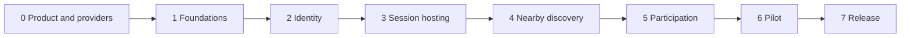

# Development roadmap

Deliver one usable flow at a time: create a session, find it nearby, then confirm a seat. Each step ends with a concrete completion check. The order below expresses dependencies; dates should be estimated after the initial scaffold and provider choices.

Unit, integration, and E2E tests are required for both API and app. Implement the relevant scenarios with each feature using the [testing strategy](./testing-strategy.md); testing is part of each step's completion criteria.

## Step 0 Resolve the product decisions

- Use personal profiles for all hosts, host approval, editable session fields, and host participation that defaults to playing and can be changed later. Confirm the initial formats.
- Use the confirmed iOS and Android platforms through Expo, worldwide hosting and discovery, and English/Italian interface support. Confirm whether the pilot includes private homes; the pilot must not establish a regional product restriction.
- Use custom NestJS username/password authentication. Finalize retained Google/Apple flows, recovery without email, username/public-name rules, account linking, and session policy in the authentication decisions. Configure Vercel and Neon/PostGIS; select geocoding and approved-detail map providers.
- Apply the confirmed [Git workflow](./git-workflow.md), with main for releases, dev for staging, and pull requests for integration. Branch rulesets and dev defaults are configured in all three repositories; plan their CI setup.
- Apply city-only discovery, approval-gated precise detail/map, current-device origin, and no-polling push updates. Use zero infrastructure spending and the accepted tests; confirm retention, audience, free durable delivery, and backups in the [operating constraints](./operational-proposal.md). Local auth has no sending-domain dependency.

**Complete when:** [Open decisions](./open-decisions.md) records the answers needed for implementation, and the MVP scope is agreed. Independent scaffolding can proceed using the documented defaults.

## Step 1 Establish the two projects

Repository setup:

- Work on feature branches derived from the existing protected `dev` branch in each repository.
- Use the configured pull request rules, merge strategies, and protected release tags. Add actual required CI check names only once those jobs exist, and version API and app releases independently.
- Configure validated `dev` changes for staging deployment or internal mobile builds, then tagged `main` releases for production delivery or store builds.
- Establish unit, integration, and E2E commands and CI jobs with the accepted coverage gates and standard GitHub Actions Linux/macOS runners. Use isolated local PostGIS containers and bounded included artifact storage; add actual passing check names to rulesets once operational, without paid runners or builds.

Backend tasks:

- Scaffold NestJS with strict TypeScript, linting, formatting, unit test support, and a supported Node.js version.
- Add environment validation, minimal health routes, global request validation, structured logs, and OpenAPI generation.
- Add Docker Compose with PostgreSQL and PostGIS, TypeORM configuration, and an initial extension migration.
- Validate Vercel Hobby, Neon Free/PostGIS, small pools, migrations, isolated environments, and password hashing cost. Verify durable event delivery and commit recovery within free quotas, without polling or paid metering.
- Commit an example environment file, local setup instructions, lockfile, and CI for lint, type checks, and tests.
- Configure Jest, NestJS TestingModule, PostgreSQL/PostGIS integration fixtures, and a Supertest HTTP E2E suite. Start with meaningful configuration or validation unit checks, migration integration checks, and API readiness over HTTP against the test database.

App tasks:

- Scaffold React Native with Expo, TypeScript, and routing.
- Establish navigation, accessible shared controls, theme tokens, loading states, and error states.
- Establish English and Italian translation catalogs, locale-aware formatting, a language setting, and a persisted preference. Keep locale independent of session geography and timezone.
- Configure API base URLs, TanStack Query, secure storage, environment examples, and basic CI.
- Document simulator and physical device setup, including API access over the local network.
- Configure Jest with jest-expo, React Native Testing Library, and a native E2E runner. Establish unit and integration examples and an installed-app smoke flow against the real test API; document Android and iOS execution prerequisites.

**Complete when:** both projects have runnable unit, integration, and E2E suites and pass the initial CI gates. The API reports database readiness, and Android and iOS test builds load a screen and call the real test API. Framework and test setup start here; they are not part of repository initialization.

## Step 2 Add identity and profiles

Depends on step 1, authentication library selection, and agreed recovery/identity/session policies. Retained Google/Apple flows also require provider registration and platform configuration.

- Implement username/password signup/login, secure credential change, and agreed recovery behavior. Implement retained social methods with native SDK or validated callback configuration; local login needs no deep link.
- Localize registration, login, credential errors, and accepted recovery screens in English and Italian.
- Add normalized username uniqueness, password credential, social identity, authentication session, and refresh token migrations. Use Argon2id, shared throttling, application tokens, refresh rotation/reuse detection, and device/global logout.
- Handle wrong credentials, identifier collisions, throttling, cancelled social login, and failed callbacks. Implement linking and recovery only after their policies are decided.
- Verify Google and Apple responses during sign-in, map them to local identities, and issue our application session. Validate our own access token signature, issuer, audience, and expiry for API requests.
- Implement profile read and update, account state checks, and authentication guards.
- Add auth tests for real password verification and safe errors, normalized username collisions, distributed throttling, credential changes, accepted recovery replay protection, refresh reuse, revoked sessions, and cross-account access.

**Complete when:** local signup/login and the retained social methods work on their agreed platforms; two users can sign in independently, edit only their own profile, and follow the accepted recovery and revocation rules. Logs contain no passwords, hashes, recovery codes, tokens, or sensitive profile data.

## Step 3 Publish hosted sessions

Depends on step 2.

- Implement venue, protected venue location, session, and participation migrations and constraints.
- Add venue forms with public versus private visibility and a public preview.
- Support worldwide venue locations and international address formats, with timezone selection tied to the venue rather than the interface language or device timezone.
- Implement draft creation with hostParticipates defaulting to true, optional approved host membership, publishing, allowed edits, and cancellation.
- Show the host's playing choice in the creation form and seat preview; retain host management permissions when the host only provides the table.
- Build session detail and hosted session screens. Add realistic fixtures for public and private venues.
- Enforce valid time, capacity, and ownership while allowing host edits with confirmed players present. Add version checks and session-specific location snapshots or venue revisions to prevent silent edits to unrelated games.
- Implement host participation toggles under the session lock, including the freed-seat result and conflict when opting into a full table.
- Cover creation rules with unit tests, transactional persistence and API contracts with integration and HTTP E2E tests, and both host participation choices in app integration and native E2E flows.

**Complete when:** a host can publish and manage a session in either playing mode. A four-player table starts with three available seats when the host plays and four otherwise. The second account can see the session but cannot read the exact private address or edit it.

## Step 4 Discover nearby tables

Depends on step 3 and geocoder selection.

- Add geographic indexes and parameterized radius, date, format, and available-seat queries.
- Implement one-time current foreground location lookup, permission explanation, settings recovery, and retry. Do not implement a manual discovery destination.
- Resolve canonical cities worldwide and support host venue positioning separately. Discovery and unapproved detail expose only the city; precise coordinates are not used for pre-approval filtering or ranking.
- Build the nearby list, filters, pagination, refresh, approximate distance labels, and no-results state.
- Redact search coordinates from logging at the application and proxy layers.
- Measure geographic query plans with representative data and verify units and coordinate ordering.
- Add real PostGIS city-search cases, HTTP E2E privacy assertions for all venue types, app integration state handling, and native location denial/retry coverage.
- Include both interface locales, multiple hemispheres, high latitudes, and searches across the antimeridian in the relevant automated scenarios.

**Complete when:** city-based nearby discovery works from the current device location, full and cancelled sessions are excluded, location failures provide recovery, and no exact location leaks through discovery or unapproved detail. Include same-city and large-city boundary cases.

## Step 5 Request and confirm seats

Depends on step 4.

- Implement membership transitions and locking transactions for approvals and capacity changes.
- Build request, withdraw, approve, reject, and personal-session screens.
- Refresh server state after mutations and display useful conflict messages if the last seat is taken.
- Restrict exact location access to eligible confirmed players and the host.
- Render the precise location map only in authorized detail after approval and clear cached location on revocation or cancellation.
- Add the scheduled completion job and cancellation history.
- Add in-app notifications, push token registration and permission handling, event-triggered delivery, and safe versioned payloads. Fetch an initial snapshot, patch UI directly from received pushes, and reconcile on app entry or explicit refresh without polling or per-push refetches.
- Cover durable delivery retries/crash recovery, duplicate/out-of-order payloads, push denial, authorized navigation from notification taps, and absence of background refresh requests.
- Add unit transition cases, integration and HTTP E2E tests for final-seat races over independent connections, and native two-account request and approval flows with cancellation and conflict recovery.

**Complete when:** two accounts complete discovery through approval; concurrent approval of the last seat admits one player; leaving frees a seat; cancellation or withdrawal revokes private location access.

## Step 6 Prepare the pilot

Depends on steps 1 through 5.

- Run the complete regression matrix in [Quality and release](./quality-and-release.md), including the suites implemented in earlier steps, Android and iOS device journeys, real-provider sign-in smoke checks, and location denial.
- Add reporting, a minimal operator workflow, account deletion processing, and published privacy and support information.
- Deploy staging on Vercel with Neon/PostGIS; validate local credential auth, retained social flows, migrations, backup recovery, redaction, and event-triggered push delivery.
- Build distributable iOS and Android test versions and run an invited pilot with personal-account players and hosts, covering English/Italian and representative locations/timezones without restricting global hosting.
- Record discovery failures, approval problems, accessibility issues, and query performance without collecting movement histories.

**Complete when:** critical defects are resolved, backups can be restored, a rollback is rehearsed, and pilot users can organize sessions without developer intervention.

## Step 7 Release and iterate

Depends on pilot results and launch readiness checks.

- Configure production environments, store listings, location permission descriptions, privacy declarations, and support contacts.
- Stabilize a release branch, validate its artifacts, merge through pull requests into `main`, tag the release, and return release fixes to `dev`. Use the documented hotfix flow for urgent production fixes.
- Require the applicable unit, integration, API HTTP E2E, and Android/iOS E2E gates to pass for the candidate revisions before release promotion.
- Run migration and API compatibility checks before deploying the production API and distributing the mobile app.
- Monitor errors, failed join attempts, empty searches, and latency. Investigate reports through the operator process.
- Prioritize improvements using pilot feedback: more formats, recurring sessions, waitlists, chat, and moderation tools. Precise approved-detail maps and push delivery are already MVP requirements.

**Complete when:** a player can install the app, use English or Italian, discover or host a real session at a chosen location worldwide, and complete the seat request and approval flow, with support and rollback procedures available.

## Dependency overview

The app can use agreed OpenAPI examples while API features are implemented. Connect each feature to staging before calling it complete. If scope must shrink, postpone optional capabilities and additional formats while retaining current-location discovery, approval-gated precise maps, in-app/push updates, privacy, and safe seat allocation.
