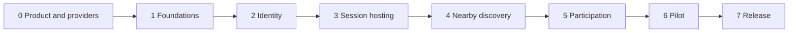

# Development roadmap

Deliver one usable flow at a time: create a session, find it nearby, then confirm a seat. Each step ends with a concrete completion check. The order below expresses dependencies; dates should be estimated after the initial scaffold and provider choices.

## Step 0 Resolve the product decisions

- Use the confirmed host approval policy and host participation choice at creation, defaulting to playing. Confirm who can host, initial formats, and rules for changing the host's playing choice later.
- Use the confirmed iOS and Android platforms through Expo. Confirm the launch area, languages, and whether the pilot includes private homes.
- Select an authentication provider supporting the confirmed email magic link, Google, and Apple methods; define account linking. Select geocoding, API hosting, and managed PostgreSQL providers; verify PostGIS availability and budget.
- Resolve session cancellation, private address disclosure, retention periods, and an operator contact for reports.

**Complete when:** [Open decisions](./open-decisions.md) records the answers needed for implementation, and the MVP scope is agreed. Independent scaffolding can proceed using the documented defaults.

## Step 1 Establish the two projects

Backend tasks:

- Scaffold NestJS with strict TypeScript, linting, formatting, unit test support, and a supported Node.js version.
- Add environment validation, minimal health routes, global request validation, structured logs, and OpenAPI generation.
- Add Docker Compose with PostgreSQL and PostGIS, TypeORM configuration, and an initial extension migration.
- Commit an example environment file, local setup instructions, lockfile, and CI for lint, type checks, and tests.

App tasks:

- Scaffold React Native with Expo, TypeScript, and routing.
- Establish navigation, accessible shared controls, theme tokens, loading states, and error states.
- Configure API base URLs, TanStack Query, secure storage, environment examples, and basic CI.
- Document simulator and physical device setup, including API access over the local network.

**Complete when:** both projects pass CI, the API reports database readiness, and iOS and Android development builds load a screen and call the API. Framework setup starts here; it is not part of repository initialization.

## Step 2 Add identity and profiles

Depends on step 1 and authentication provider selection.

- Implement email magic link, Google, and Apple sign-in, app return routing, logout, token expiry, and secure token storage on iOS and Android.
- Handle expired and reused magic links, resend requests, cancelled social sign-in, and failed callbacks. Define and implement account linking only after its policy is decided.
- Verify token signature, issuer, audience, and expiry in NestJS; map the identity to a local user.
- Implement profile read and update, account state checks, and authentication guards.
- Add initial authorization tests and fixtures for host, player, and unrelated user accounts.

**Complete when:** all three sign-in methods work on iOS and Android development builds; two users can sign in independently, edit only their own profile, and recover cleanly from expired links and sessions. Logs contain no authentication tokens, magic-link tokens, authorization codes, or sensitive profile data.

## Step 3 Publish hosted sessions

Depends on step 2.

- Implement venue, protected venue location, session, and participation migrations and constraints.
- Add venue forms with public versus private visibility and a public preview.
- Implement draft creation with hostParticipates defaulting to true, optional approved host membership, publishing, allowed edits, and cancellation.
- Show the host's playing choice in the creation form and seat preview; retain host management permissions when the host only provides the table.
- Build session detail and hosted session screens. Add realistic fixtures for public and private venues.
- Enforce time, capacity, ownership, and venue-edit restrictions on the API.

**Complete when:** a host can publish and manage a session in either playing mode. A four-player table starts with three available seats when the host plays and four otherwise. The second account can see the session but cannot read the exact private address or edit it.

## Step 4 Discover nearby tables

Depends on step 3 and geocoder selection.

- Add geographic indexes and parameterized radius, date, format, and available-seat queries.
- Implement one-time foreground location lookup, permission explanation, and manual town selection.
- Build the nearby list, filters, pagination, refresh, approximate distance labels, and no-results state.
- Redact search coordinates from logging at the application and proxy layers.
- Measure geographic query plans with representative data and verify units and coordinate ordering.

**Complete when:** test sessions inside and outside a selected radius appear correctly; full and cancelled sessions are excluded; manual search works with GPS disabled; private exact points never affect public radius filtering or ordering.

## Step 5 Request and confirm seats

Depends on step 4.

- Implement membership transitions and locking transactions for approvals and capacity changes.
- Build request, withdraw, approve, reject, and personal-session screens.
- Refresh server state after mutations and display useful conflict messages if the last seat is taken.
- Restrict exact location access to eligible confirmed players and the host.
- Add the scheduled completion job and cancellation history.

**Complete when:** two accounts complete discovery through approval; concurrent approval of the last seat admits one player; leaving frees a seat; cancellation or withdrawal revokes private location access.

## Step 6 Prepare the pilot

Depends on steps 1 through 5.

- Complete the test matrix in [Quality and release](./quality-and-release.md), including real devices and location denial.
- Add reporting, a minimal operator workflow, account deletion processing, and published privacy and support information.
- Deploy staging with HTTPS, managed PostGIS, migrations, backup configuration, log redaction, and error monitoring.
- Build distributable iOS and Android test versions and run a small invited pilot with local players or a store.
- Record discovery failures, approval problems, accessibility issues, and query performance without collecting movement histories.

**Complete when:** critical defects are resolved, backups can be restored, a rollback is rehearsed, and pilot users can organize sessions without developer intervention.

## Step 7 Release and iterate

Depends on pilot results and launch readiness checks.

- Configure production environments, store listings, location permission descriptions, privacy declarations, and support contacts.
- Run migration and API compatibility checks before deploying the production API and distributing the mobile app.
- Monitor errors, failed join attempts, empty searches, and latency. Investigate reports through the operator process.
- Prioritize improvements using pilot feedback: push notifications, more formats, maps, recurring sessions, waitlists, chat, store verification, and moderation tools.

**Complete when:** a player in the launch area can install the app, discover a real session, and receive a confirmed seat, with support and rollback procedures available.

## Dependency overview

The app can use agreed OpenAPI examples while API features are being implemented. Connect each feature to the staging API before calling it complete. If scope must shrink, postpone maps, push, and additional formats while preserving location privacy and safe seat allocation.
