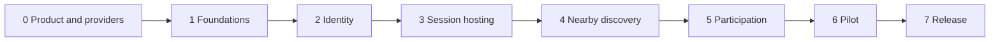

# Development roadmap

Deliver one usable flow at a time: create a session, find it nearby, then confirm a seat. Each step ends with a concrete completion check. The order below expresses dependencies; dates should be estimated after the initial scaffold and quota/compatibility measurements.

Unit, integration, and E2E tests are required for both API and app. Implement the relevant scenarios with each feature using the [testing strategy](./testing-strategy.md); testing is part of each step's completion criteria.

## Step 0 Apply the complete format specification

- Use personal profiles for all hosts, host approval, editable session fields, and host participation that defaults to playing and can be changed later. Apply the complete [format catalogue/configuration](./formats.md), including official, community, historical, device-play and custom organizing paths.
- Use the confirmed iOS and Android platforms through Expo, worldwide hosting and discovery, and English/Italian interface support. Include private homes and require 18+ self-declaration; the invited pilot must not establish a regional product restriction.
- Use Google/Apple-only sign-in with NestJS-issued application sessions and a separate public profile name. Apply accepted linking/session/SDK/identifier/callback rules. Provision provider registrations, Frankfurt Vercel/Neon resources, Geoapify Free and MapLibre development builds.
- Apply the confirmed [Git workflow](./git-workflow.md), with main for releases, dev for staging, and pull requests for integration. Branch rulesets and dev defaults are configured in all three repositories; plan their CI setup.
- Apply city-only discovery, approval-gated detail/map, current-device origin, and no-polling push updates. Use zero spending and accepted tests; implement accepted retention, audience, durable delivery, and manual encrypted backup duties in the [operations](./operations.md). No email sender or local credentials are required.

**Complete when:** no product decisions remain open, the [formats specification](./formats.md) defines every organizing family and Custom, and each reviewed preset has source/version metadata. Source verification, implementation and real release evidence remain tracked work; scaffolding can proceed now.

## Step 1 Establish the two projects

Repository setup:

- Work on feature branches derived from the existing protected `dev` branch in each repository.
- Use the configured pull request rules, merge strategies, and protected release tags. Add actual required CI check names only once those jobs exist, and version API and app releases independently.
- Configure validated `dev` changes for staging deployment or internal mobile builds, then tagged `main` releases for production delivery or store builds.
- Establish unit, integration, and E2E commands and CI jobs with the accepted coverage gates and standard GitHub Actions Linux/macOS runners. Use isolated local PostGIS containers and bounded included artifact storage; add actual passing check names to rulesets once operational, without paid runners or builds.

Backend tasks:

- Scaffold NestJS with strict TypeScript, linting, formatting, unit tests and supported Node.js. Add versioned catalogue/profile/schema seed data and generated client metadata; all-format support is a first-release requirement, not a later expansion.
- Add environment validation, minimal health routes, global request validation, structured logs, and OpenAPI generation.
- Add Docker Compose with PostgreSQL and PostGIS, TypeORM configuration, and an initial extension migration.
- Validate Vercel Hobby, Neon Free/PostGIS, small pools, migrations, isolated environments, and provider callback configuration. Prototype the selected Workflow/Nest Vercel consumer, durable command acceptance and crash recovery within free quotas, including 202/pending UI behavior without polling. Failed technical acceptance blocks launch, not a new product vote.
- Commit an example environment file, local setup instructions, lockfile, and CI for lint, type checks, and tests.
- Configure Jest, NestJS TestingModule, PostgreSQL/PostGIS integration fixtures, and a Supertest HTTP E2E suite. Start with meaningful configuration or validation unit checks, migration integration checks, and API readiness over HTTP against the test database.

App tasks:

- Scaffold React Native with Expo, TypeScript, and routing.
- Establish navigation, accessible shared controls, theme tokens, loading states, and error states.
- Establish English and Italian translation catalogs, locale-aware formatting, a language setting, and a persisted preference. Keep locale independent of session geography and timezone.
- Configure API base URLs, TanStack Query, secure storage, environment examples, and basic CI. Provision the chosen app/service identifiers, Google/Apple clients, signing fingerprints, APNs/FCM credentials and Geoapify keys; stable staging/production Vercel hostnames are provisioning outputs.
- Document simulator and physical device setup, including API access over the local network.
- Configure Jest with jest-expo, React Native Testing Library, and Maestro. Establish unit and integration examples and an installed-app smoke flow against the real test API; document Android and iOS execution prerequisites.

**Complete when:** both projects have runnable unit, integration, and E2E suites and pass the initial CI gates. The API reports database readiness, and Android and iOS test builds load a screen and call the real test API. Framework and test setup start here; they are not part of repository initialization.

## Step 2 Add identity and profiles

Depends on step 1 and provisioning the accepted provider registrations/platform callbacks; auth policies and SDK choices are already accepted.

- Implement Google and Apple through native SDKs or validated browser flows for each platform; first verified sign-in creates the internal profile, followed by 18+ declaration/policy acknowledgement and a separate public name.
- Localize sign-in, profile onboarding, cancellation, callback errors, and provider recovery guidance in English and Italian.
- Add issuer/subject identity uniqueness, application user/profile, authentication session, and refresh token migrations. Use shared throttling, token verification, rotation/reuse detection, and device/global logout.
- Handle invalid/replayed provider credentials, identity collisions, throttling, cancelled sign-in, and failed callbacks. Implement explicit linking/unlinking, last-provider protection, fresh verification, 18+ onboarding and immediate session revocation; do not add local passwords or reset codes.
- Verify Google and Apple responses during sign-in, map them to local identities, and issue our application session. Validate our own access token signature, issuer, audience, and expiry for API requests.
- Implement profile read/update, account state checks, terms/community-rule acceptance, versioned public-name filtering and auth guards. Deleting accounts remain disabled; real auth never accepts demo roles.
- Add auth tests for provider signature/issuer/audience/nonce validation, replay, identity uniqueness, safe display-name collisions, throttling, linking ownership, refresh reuse, revocation, and cross-account access.

**Complete when:** Google and Apple work on the agreed platforms through verified SDK/callback flows, first sign-in creates a profile, returning sign-in resolves the same user, and identity linking/session revocation follow the accepted rules. Logs contain no provider credentials, codes, tokens, or sensitive profile data.

## Step 3 Publish hosted sessions

Depends on step 2.

- Implement venue/location/session/participation plus FormatDefinitionRevision/RulesProfile, SessionFormat, group/assignment and suggestion migrations. Seed the official-hub coverage and named community/historical/custom paths; distinguish host-declared templates from verified summaries.
- Add venue forms with public-space/private-home categories and a city-only preview; both categories protect exact location equally.
- Support worldwide venue locations and international address formats, with timezone selection tied to the venue rather than the interface language or device timezone.
- Implement draft creation with hostParticipates defaulting to true, optional approved host membership, publishing, allowed edits, and cancellation.
- Build the progressive format picker/setup with en/it explanations, media, materials, rules/proxy/intent and layout/team/role controls. Show the playing-host seat and compatible default assignment; non-playing hosts retain management only. Validate total capacity separately from per-game structure and allow explicit solo/custom layouts.
- Build session detail and hosted session screens. Add realistic fixtures for public and private venues.
- Enforce time/capacity/ownership, all documented numeric/text/admission limits and public-content filtering while preserving host edits with confirmed players. Add version checks and private snapshots; mirror full playLanguage/playStyleNotes/accessibilityNotes DTOs and saved-venue deletion semantics.
- Implement host participation toggles under the session lock, including the freed-seat result and conflict when opting into a full table.
- Cover creation rules with unit tests, transactional persistence and API contracts with integration and HTTP E2E tests, and both host participation choices in app integration and native E2E flows.

**Complete when:** a host can publish and manage a session in either playing mode. A four-player table starts with three available seats when the host plays and four otherwise. The second account can see the session but cannot read the exact private address or edit it.

## Step 4 Discover nearby tables

Depends on step 3 and the configured Geoapify Free adapter.

- Add geographic and format-code/base/family/modifier indexes and parameterized radius/date/seat/medium/intent queries. Resolve aliases without merging different rules authorities; public cards stay city-only with a compact format label.
- Implement one-time current foreground location lookup, permission explanation, settings recovery, and retry. Do not implement a manual discovery destination.
- Resolve canonical cities worldwide and support host venue positioning separately. Discovery and unapproved detail expose only the city; precise coordinates are not used for pre-approval filtering or ranking.
- Build the nearby list, filters, pagination, explicit refresh and no-results state, without distance labels or secret-coordinate ranking.
- Use body-based POST discovery and disable body logging so platform access URLs do not contain coordinates; verify redaction at application/proxy/provider boundaries.
- Measure geographic query plans with representative data and verify units and coordinate ordering.
- Add real PostGIS city-search cases, HTTP E2E privacy assertions for all venue types, app integration state handling, and native location denial/retry coverage.
- Include both interface locales, multiple hemispheres, high latitudes, and searches across the antimeridian in the relevant automated scenarios.

**Complete when:** city-based nearby discovery works from the current device location, full and cancelled sessions are excluded, location failures provide recovery, and no exact location leaks through discovery or unapproved detail. Include same-city and large-city boundary cases.

## Step 5 Request and confirm seats

Depends on step 4 and the durable-command prototype from step 1.

- Implement membership transitions and actor/command/session/membership/cursor lock order. Deliver immediate deletion/suspension/cancellation/withdrawal/block effects, including stopped-worker and concurrent-action cases; permit leaving until end while joining remains future-only.
- Build one-seat request/withdraw/approve/reject and personal-session screens, optional team/role preferences and host-only assignment. Structural readiness never reserves a seat, bypasses approval or prevents safety withdrawal.
- Apply committed mutation responses directly; show pending for accepted asynchronous commands and useful conflict states for the last seat. Use only explicit/entry recovery reads, no polling or per-push refetch.
- Restrict exact location access to eligible confirmed players and the host.
- Render the precise location map only in authorized detail after approval and clear cached location on revocation or cancellation.
- Add completion-generation jobs and terminal cancellation/completion history; unrelated membership versions must not suppress completion.
- Add UserSyncCursor and GET /me/snapshot, per-key projections/tombstones, listener buffering and auth/request generation guards. Implement terminal command events, two-minute execution deadlines, seven-day logical idempotency replay and explicit Outcome unknown recovery. Register push devices; entry/re-entry or explicit reads recover missed events without polling/per-push fetches.
- Cover durable delivery retries/crash recovery, duplicate/out-of-order payloads, push denial, authorized navigation from notification taps, and absence of background refresh requests.
- Add unit transition cases, integration and HTTP E2E tests for final-seat races over independent connections, and native two-account request and approval flows with cancellation and conflict recovery.

**Complete when:** two accounts complete approval with safe capacity; the [edge-case scenarios](./testing-strategy.md#edge-case-regression-scenarios) for command outcomes, snapshot ordering, immediate safety effects, blocking, post-start leaving, limits and expired idempotency keys pass without hidden polling.

## Step 6 Prepare the pilot

Depends on steps 1 through 5.

- Run the scenario matrix in [Testing strategy](./testing-strategy.md#required-scenario-coverage) and collect the evidence required by [Quality and release](./quality-and-release.md), including Android/iOS journeys, real-provider sign-in, push and location denial.
- Add operator moderation/removal/suspension, urgent/ordinary report triage, private appeals and bilingual terms/privacy/support/deletion pages. Daily bounded cleanup resumes physical DeletionRequests; cancellations/access denial already committed. Build the public signed-out local demo, complete both fictional roles and prove zero external traffic/production credential access.
- Deploy Frankfurt staging on Vercel with Neon/PostGIS; validate both social flows on both platforms, geocoding/maps, migrations, free quotas, Workflow consumer/crash recovery, redaction and real push. Implement encrypted weekly/pre-migration local exports and complete a private restore/ledger drill.
- Build distributable iOS and Android test versions and run an invited pilot with personal-account players and hosts, covering English/Italian and representative locations/timezones without restricting global hosting.
- Record discovery failures, approval problems, accessibility issues, and query performance without collecting movement histories.

**Complete when:** critical defects are resolved, backup/ledger restore and rollback are rehearsed, moderation and the isolated demo are usable, and pilot users organize sessions without developer intervention. Store-access acceptance remains a release gate with recorded evidence.

## Step 7 Release and iterate

Depends on pilot results and launch readiness checks.

- Configure production/store metadata, permission/privacy declarations, support contacts and exact demo App access/review instructions. Obtain acceptance of the demo access arrangement where required; actual store acceptance and real-provider smoke evidence gate publication.
- Stabilize a release branch, validate its artifacts, merge through pull requests into `main`, tag the release, and return release fixes to `dev`. Use the documented hotfix flow for urgent production fixes.
- Require the applicable unit, integration, API HTTP E2E, and Android/iOS E2E gates to pass for the candidate revisions before release promotion.
- Run migration and API compatibility checks before deploying the production API and distributing the mobile app.
- Monitor errors, failed join attempts, empty searches, and latency. Investigate reports through the operator process.
- Prioritize optional recurring sessions, waitlists, chat and richer moderation using pilot feedback. Maintain/extend catalogue data and custom templates continuously; every format family, maps and push already belong to the first release.

**Complete when:** a player can install the app, use English or Italian, discover or host a real session at a chosen location worldwide, and complete the seat request and approval flow, with support and rollback procedures available.

## Dependency overview

The app can use agreed OpenAPI examples while API features are implemented. Connect each feature to staging before calling it complete. If scope must shrink, postpone optional gameplay/deck/tournament automation while retaining complete format representation and current-location discovery, approval-gated precise maps, in-app/push updates, privacy, and safe seat allocation.
